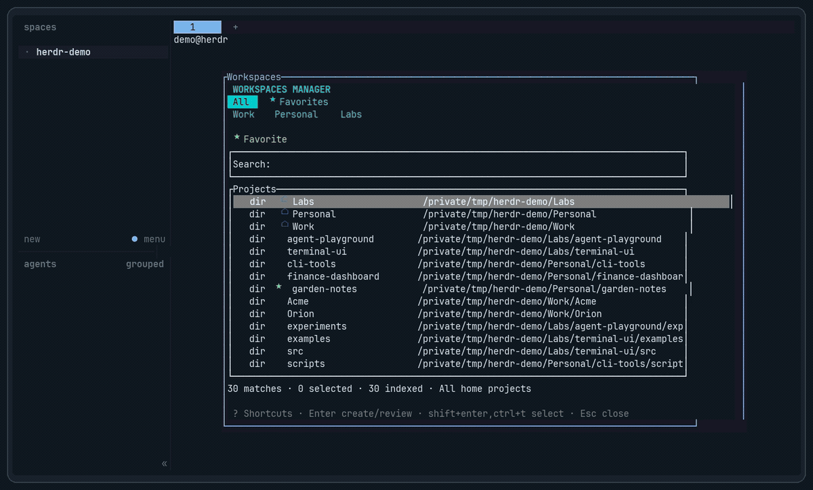

# Herdr workspaces manager

A fast, standalone Rust picker for finding local projects and opening them in new Herdr workspaces, panes, or tabs. It supports Git repositories and ordinary folders, search roots, favorites, and recent projects—without requiring Python, Node, or a package manager at launch.

[](docs/workspaces-manager-demo.mp4)

*Click the preview to watch the full demo.*

## Install and open

Requires **Herdr 0.9.3+** on macOS or Linux.

```sh
herdr plugin install dardT/herdr-workspaces-manager
herdr plugin action invoke open --plugin herdr-workspaces-manager
```

Add a shortcut in `~/.config/herdr/config.toml` for quick access:

```toml
[[keys.command]]
key = "prefix+shift+o"
type = "plugin_action"
command = "herdr-workspaces-manager.open"
description = "Find projects and open workspaces or panes"
```

Reload Herdr with `herdr server reload-config`. With the default prefix, use **Ctrl+B**, then **Shift+O**.

## Usage

Type to fuzzy-search project names, paths, and Git branches. Use `/` for an absolute-path prefix or `~/` for a path under your home directory. Switch between **All**, **Favorites**, **Recent**, and configured roots with **Ctrl+G** / **Ctrl+Shift+G** or by clicking a scope.

- **Enter** creates a new workspace for the highlighted project.
- **Ctrl+T** opens it in a pane or tab in the current workspace.
- **Ctrl+Space** adds it to a batch; then use **Enter** or **Ctrl+T** to review and confirm the destination.
- **Ctrl+F** toggles a favorite; **Ctrl+R** toggles the highlighted directory as a search root.

Git repositories, linked worktrees, and regular directories are labelled `git`, `wt`, and `dir`. Recent projects are ordered by most recently opened; up to 30 are retained.

### Shortcuts

| Action | Keys |
| --- | --- |
| Create workspace / confirm batch | **Enter** |
| Open in current workspace | **Ctrl+T** |
| Toggle batch selection | **Ctrl+Space** |
| Next / previous scope | **Ctrl+G** / **Ctrl+Shift+G** |
| Browse into / out of a directory | **Tab** / **Shift+Tab** |
| Toggle favorite | **Ctrl+F** |
| Toggle as root | **Ctrl+R** |
| Show shortcuts / close picker | **?** / **Esc** |

## Configuration

The plugin creates `config.json` on first launch. Locate it with:

```sh
herdr plugin config-dir herdr-workspaces-manager
```

Edit the existing JSON object to preserve your roots, favorites, and keybindings. For example:

```json
{
  "discovery_profile": "auto",
  "rules": [
    { "priority": 100, "action": "include", "path": "~/Library/Developer" },
    { "priority": 100, "action": "exclude", "path": "~/Downloads" },
    { "priority": 200, "action": "include", "path": "~/Downloads/my-project" }
  ],
  "max_pane_columns": 2,
  "max_pane_rows": 2
}
```

`discovery_profile: "auto"` uses `macos` on macOS and `unix` elsewhere. The macOS profile searches your home directory and `/Users/Shared`; the Unix profile searches accessible paths while excluding system trees. Both respect Git ignore files and skip common generated directories such as `.venv`, `node_modules`, `target`, and `dist`.

Rules match absolute or `~/` paths (with globs), apply to descendants, and resolve by priority. Use priorities of 100 or higher to override defaults or Git ignores. Use a literal include rule to reopen an excluded tree or search a macOS-profile path outside your home directory and `/Users/Shared`.

Other settings include `roots`, `favorites`, `max_depth` (20), `include_hidden` (false), `focus_created` (false), and `keybindings` (`toggle_root` defaults to `ctrl+r`). The former `add_root` binding migrates to `toggle_root`; `remove_root` is retired. Adding a root keeps the current scope; removing the active root returns to All. Recent history is stored separately in `recent.json`.

## Development and releases

The installer downloads and verifies a matching release binary for macOS (Apple Silicon or Intel) and Linux (x86-64 or ARM64). Unsupported platforms fall back to a Rust/Cargo source build. Forks can set `HERDR_WORKSPACES_MANAGER_REPO=OWNER/REPO` to use a different release repository.

For local development, install Rust/Cargo and run:

```sh
task link    # build and link this checkout to Herdr
task check   # format and run Clippy
task release-check
```

See [CONTRIBUTING.md](CONTRIBUTING.md) for release instructions and [CHANGELOG.md](CHANGELOG.md) for release notes.
